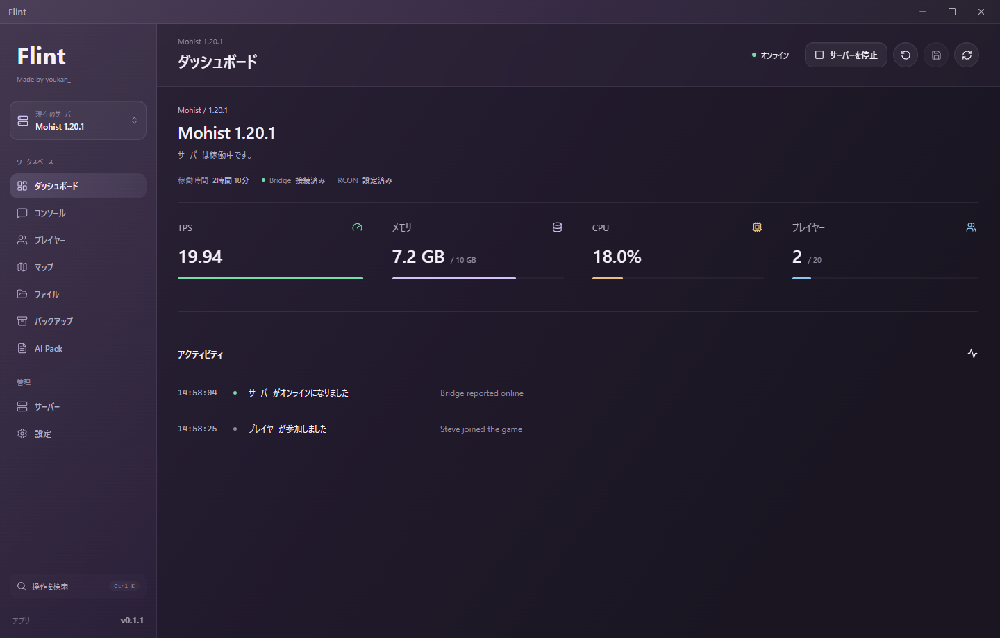
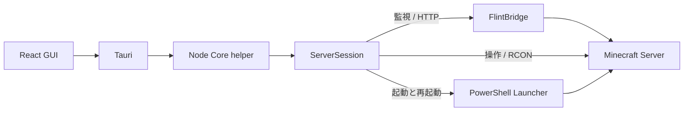

  

<h1 align="center">Flint</h1>

  <strong>Minecraft Server Control Center</strong> 
  サーバーを作る。動かす。様子を見る。問題を調べる。 
  自分のWindows PCに、Minecraftサーバーの管理拠点を。

  
  
  
  

  <a href="https://github.com/youkankankan/Flint/releases">ダウンロード</a> ·
  <a href="docs/releases/v0.1.1.md">v0.1.1の変更内容</a> ·
  <a href="#はじめかた">はじめかた</a> ·
  <a href="#動作環境">動作環境</a> ·
  <a href="https://github.com/youkankankan/Flint/issues">不具合を報告</a>

---

Flintは、**ローカルのMinecraftサーバーを作成・起動・管理するWindowsデスクトップアプリ**です。
Minecraftサーバー本体ではなく、その隣で使う管理ツールです。旧称は **Overseer**。

ダークパープルと淡いラベンダーのGlass UIで、Console、ファイル、プレイヤー、バックアップをひとつに。
クラッシュしたときは、ログや設定をまとめた **AI Pack** を作り、原因調査に必要な情報を持ち出せます。

ブラウザデモの表示例です。数値・プレイヤー・履歴はデモデータで、実サーバーの計測結果ではありません。

## できること

| ワークスペース | 主な機能 |
| :--- | :--- |
| **Dashboard** | サーバー状態、TPS、CPU、メモリ、人数、稼働時間、最近のアクティビティをまとめて確認。 |
| **Console** | 画面全体を使うログ表示、検索・コピー、Minecraftコマンド補完、コマンド履歴、自然な自動スクロール。 |
| **ファイル / Mod解析** | Explorer風の一覧、矩形選択、ドラッグ＆ドロップ、名前変更、テキスト編集。Modの有効・無効と依存関係も確認。 |
| **プレイヤー** | 接続中・最後に取得した情報を分類して表示。Minecraft風のインベントリで移動・交換・削除・追加。 |
| **マップ** | 導入済みのローカルDynmapを表示。ワールドや地図の切替、オンラインプレイヤーへの追従。 |
| **バックアップ** | 停止中のワールドバックアップ、履歴、対象・サイズの確認、復元前のdry-run。 |
| **AI Pack** | 問題説明、ログ、起動セッション、Mod・設定、性能履歴、任意の詳細診断をMarkdown / ZIPへ整理。 |
| **サーバー / 設定** | 新規作成・既存サーバー選択、Java・JVM引数・properties設定、接続アシスタント、日本語・英語切替。 |

**更新もアプリ内から。** 起動時・定期・復帰時に自動確認し、新しい版があれば変更内容を通知します。
適用はユーザーの確認後。処理中のバックアップなどがある場合は中止し、Minecraftサーバーを勝手に停止しません。

詳しい追加・修正履歴は、[v0.1.1 リリースノート](docs/releases/v0.1.1.md)にまとめています。

## はじめかた

> [!IMPORTANT]
> [GitHub Releases](https://github.com/youkankankan/Flint/releases) からインストーラーを取得してください。
> このリポジトリは配布・説明用です。ソースコードは公開していません。

1. **インストール** — Releasesの `Flint_<version>_x64-setup.exe` を実行します。通常はこのNSISインストーラーを使います。
2. **サーバーを用意** — 新しく作る場合は「サーバー → 新しいサーバーを作成」。既存サーバーはフォルダーを選び、初期設定を確認します。
3. **設定を確認** — 対応するJava、メモリ、保存先、ゲームポートを確認し、Minecraft EULAに明示的に同意します。
4. **起動して確認** — Dashboardから起動し、Consoleで進行状況を確認します。作成完了とMinecraftの起動完了は別の状態です。

通常の利用者がNode.jsやRustを入れる必要はありません。**Minecraftを動かすための対応Javaは別途必要**です。
`flint-core-helper.exe` はアプリに同梱される内部部品なので、単独で起動するものではありません。

> [!NOTE]
> 配布先を `youkankankan/Flint` に移行しました。旧URLを参照する既存版は、このReleaseのインストーラーで一度更新してください。
> 以前渡されたv0.1.1でも更新確認が失敗する場合は同様です。今回の配布版から新しい更新先を使用します。

### 新しく作成できるサーバー

| ブランド | 主な用途 | 導入方式 |
| :--- | :--- | :--- |
| **Vanilla** | Minecraft標準のサーバー | 公式server Jar |
| **Paper / Purpur** | Bukkit系プラグインを使う環境 | 対応する配布ビルド |
| **Fabric** | FabricのMod環境 | 公式Server Launcher |
| **Forge / NeoForge** | 各loaderに対応したMod環境 | 公式installerと生成された起動引数ファイル |
| **Mohist** | 対応Mod・プラグインを使うハイブリッド環境 | 配布情報とチェックサムが対応する公式アーカイブビルド |

ブランドごとに実在するバージョン・ビルドを取得します。すべての過去版・beta・組合せに対応するわけではありません。
Spigot / Bukkitの自動作成、Javaの自動インストール、Bridgeの自動導入は未対応です。
[対応範囲と導入方式の詳細](docs/server-creation.md)

### 詳細監視・地図を使うには

- **FlintBridge**：対応するBukkit系サーバー内で動く補助プラグイン。プレイヤー詳細、オンラインのインベントリ操作、追加診断などに使います。
- **Dynmap**：マップ表示には別途ローカルDynmapが必要です。Flint自体が地形を描画するわけではありません。
- Forge / NeoForge / FabricへBukkit版FlintBridgeをそのまま入れることはできません。取得できない情報は未取得として表示します。

> [!WARNING]
> BridgeやModの交換、ワールド・playerdataの編集前にはバックアップを確保してください。
> プラグインの交換は正常停止後に行い、旧OverseerとFlintで同じサーバーを同時操作しないでください。

## 安全性と、できないこと

- **アプリを閉じてもMinecraftは独立稼働**。サーバーのプロセス寿命はdetached PowerShellランチャーが管理します。
- **監視と操作を分離**。監視はローカルHTTP Bridge、コマンドはRCON。RCONで頻繁な監視コマンドを送る方式には戻しません。
- **不明なら変更しない**。ファイル・Mod変更とバックアップは停止を確認し、共有ロックと操作先の照合を通します。
- **AIへ自動送信しない**。AI Packはローカル出力です。マスクは完全ではないため、共有前にプレビューを確認してください。
- **公開できたと決めつけない**。UPnP転送設定やローカルTCP応答は、インターネットからの接続保証ではありません。RCON・Bridgeのポートは公開対象にしません。
- **復元dry-runは事前確認**。ワールドを自動復元する機能ではありません。
- **開発中のアプリ**。全ブランド・全Mod・長時間稼働・旧版からの更新を網羅した動作保証ではありません。[リリースノートの既知の制限](docs/releases/v0.1.1.md)も確認してください。

## 使い方を調べる

| やりたいこと | ドキュメント |
| :--- | :--- |
| サーバーを新しく作る | [新規作成と対応ブランド](docs/server-creation.md) |
| ファイルやModを管理する | [ファイル操作](docs/server-file-browser.md) / [Mod解析](docs/mod-explorer.md) |
| プレイヤーの持ち物を見る・編集する | [インベントリ操作と安全性](docs/inventory-controls.md) / [テクスチャ表示](docs/item-visuals.md) |
| ログ・コマンド・過去履歴を扱う | [Consoleとログ保持](docs/console-session.md) |
| 参加用のポートや接続先を確認する | [接続アシスタント](docs/connection-assistant.md) |
| クラッシュや重さを調べる | [AI Packと設定編集](docs/support-pack-and-config-editor.md) |
| 更新する・配布する | [自動更新とRelease手順](docs/auto-update.md) |
| 旧Overseerから移行する | [名称・設定・保存領域の移行](docs/flint-rename.md) |

## 動作環境

- Windows x64
- 選択したMinecraft・サーバーブランドに対応するJava
- インストーラーの取得と更新にはインターネット接続

Node.js・Rust・ビルド環境は、配布版を利用するためには不要です。
ダウンロードしたプロジェクトをビルドするのではなく、Releasesのインストーラーから利用してください。

<strong>内部構成とServerSessionの境界</strong>

GUIはBridge・RCON・ランチャー・ログ・バックアップを直接扱いません。
`ServerSession` がsnapshotとコマンドを受け、`SnapshotBuilder` / `CommandRouter` と各サービスへ処理を委譲します。
アプリ全体設定とサーバー別設定は分離し、操作対象のパスは `ServerContext` で渡します。

アプリ本体・helper・Bridgeの実装は非公開です。この公開リポジトリには配布物と利用者向けドキュメントだけを置いています。

---

  <strong>Flint</strong> · Made by youkan_ 
  Minecraftの非公式管理ツールです。Mojang・Microsoftの公式製品ではありません。

